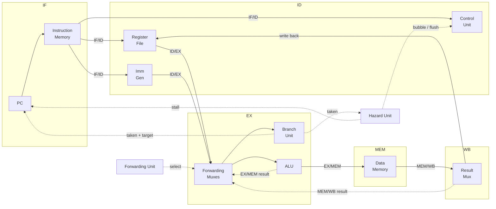

# 5-Stage Pipelined RISC-V Processor (RV32I) in Verilog

A synthesizable 32-bit RISC-V processor with a classic **IF → ID → EX → MEM → WB** pipeline, written in Verilog HDL. It is the pipelined successor to my [single-cycle RISC-V CPU](https://github.com/athwaniprahlaad22-byte/single-cycle-riscv-cpu-main): the single-cycle datapath is split into five stages, and the hazards that pipelining introduces are handled in hardware.

- **Harvard architecture.** Separate instruction and data memories, so there are no structural hazards.
- **Data forwarding.** EX/MEM and MEM/WB bypass paths into EX, where the most recent write takes priority.
- **Load-use hazard detection.** The pipeline stalls for exactly 1 cycle.
- **Control hazards.** Branches are predicted not-taken and resolved in EX, with a 2-stage flush on a misprediction.
- **Self-checking testbenches.** 8 testbenches (105 checks) cover stalls, forwarding and branches, and all of them pass.
- **Performance counters.** Cycles, retired instructions, stalls and flushes are counted so you can measure CPI.

---

## Pipeline Architecture



| Stage | Work done | Key modules |
|-------|-----------|-------------|
| **IF**  | Fetch the instruction at PC, compute PC+4 | `instr_mem` |
| **ID**  | Decode, read registers, generate the immediate, detect load-use | `control_unit`, `regfile`, `imm_gen`, `hazard_unit` |
| **EX**  | Forward operands, run the ALU, resolve branches/jumps | `forwarding_unit`, `alu_control`, `alu`, `branch_unit` |
| **MEM** | Load from / store to data memory | `data_mem` |
| **WB**  | Choose the ALU result or the loaded data, write it to the register file | (mux in `riscv_pipeline`) |

---

## Hazard Handling

### Structural hazards: Harvard memories
Instruction memory (`instr_mem`) and data memory (`data_mem`) are separate. IF and MEM can therefore both access memory in the same cycle without a port conflict.

### Data hazards: forwarding
The forwarding unit compares the source registers of the instruction in EX against the destination registers of the two instructions ahead of it:

| Priority | Condition | Operand taken from |
|----------|-----------|--------------------|
| 1 | `EX/MEM.RegWrite` and `EX/MEM.rd != 0` and `EX/MEM.rd == rs` | ALU result of the previous instruction |
| 2 | `MEM/WB.RegWrite` and `MEM/WB.rd != 0` and `MEM/WB.rd == rs` | Write-back value (ALU result or loaded data) |
| 3 | otherwise | Register file |

EX/MEM is checked first. If two instructions in flight both write the same register, the **most recent** value is used. The register file is also **write-through**, which covers a dependency three instructions apart (WB writing while ID reads in the same cycle). Branch comparisons and store data both use the forwarded operands.

### Load-use hazard: 1-cycle stall
A load's data is only available at the end of MEM, too late to forward to the very next instruction. The hazard unit detects this case:

```
stall = ID/EX.MemRead && ID/EX.rd != 0 &&
        ((uses_rs1 && ID/EX.rd == IF/ID.rs1) || (uses_rs2 && ID/EX.rd == IF/ID.rs2))
```

When it fires, the PC and IF/ID hold for one cycle and a bubble goes into ID/EX. The next cycle, MEM/WB forwarding supplies the loaded value. The `uses_rs1`/`uses_rs2` flags come from the decoder, so immediate bits in I-type instructions never cause a false stall.

```
cycle:          1    2    3    4    5    6    7
lw  x5,0(x1)    IF   ID   EX   MEM  WB
add x6,x5,x5         IF   ID   ID   EX   MEM  WB      <- 1-cycle stall, x5 forwarded from MEM/WB
```

### Control hazards: predict-not-taken, 2-stage flush
The pipeline keeps fetching sequentially. BEQ, BNE and JAL are resolved in **EX** by `branch_unit`. If one is taken, the two wrong-path instructions in IF/ID and ID/EX are turned into NOPs and the PC is redirected to the target. Branches that aren't taken cost nothing.

```
cycle:          1    2    3    4    5    6
beq x1,x2,L     IF   ID   EX   MEM  WB
(wrong path)         IF   ID   --                     <- flushed
(wrong path)              IF   --                     <- flushed
L: ...                         IF   ID   EX
```

See [docs/pipeline_design.md](docs/pipeline_design.md) for detailed per-signal behaviour.

---

## Supported Instructions

| Type | Instructions |
|------|--------------|
| R-type | `ADD SUB AND OR XOR SLL SRL SRA SLT SLTU` |
| I-type ALU | `ADDI ANDI ORI XORI SLTI SLTIU SLLI SRLI SRAI` |
| Memory | `LW SW` |
| Branch | `BEQ BNE` |
| Jump | `JAL` |

Unsupported opcodes decode as NOPs.

---

## Verification

Every testbench is **self-checking**: it compares the final register and memory state against expected values and prints `TEST PASSED` or `TEST FAILED`. The full-CPU tests also check the **exact number of stalls and flushes**. That proves the hazard logic fires when it should and never fires when it shouldn't.

Test programs are written directly in Verilog with a small encoder library (`tb/rv32i_encode.vh`), so no RISC-V toolchain is needed:

```verilog
prog(LW  (5, 1, 4));     // lw   x5, 4(x1)
prog(ADDI(6, 5, 1));     // addi x6, x5, 1     <- load-use: expect 1 stall
prog(BNE (10, 0, -8));   // bne  x10, x0, -8
```

| Testbench | What it covers | Checks | Stalls | Flushes | CPI |
|-----------|----------------|:------:|:------:|:-------:|:---:|
| `tb_alu` | All 10 ALU ops, overflow, signed vs unsigned, shift edge cases | 21 | | | |
| `tb_regfile` | x0 hardwired, read/write, same-cycle write-through | 7 | | | |
| `tb_forwarding_unit` | EX/MEM vs MEM/WB priority, x0 and RegWrite=0 exclusions | 9 | | | |
| `tb_hazard_unit` | Load-use on rs1 and rs2, no false stalls, branch flush | 7 | | | |
| `tb_cpu_forwarding` | Back-to-back RAW chains, recent-write priority, WB→ID bypass, store-data forwarding | 17 | 0 | 0 | 1.17 |
| `tb_cpu_load_use` | Load-use on rs1, rs2 and store data; distance-2 use; I-type immediate false-positive; load to x0 | 13 | 4 | 0 | 1.40 |
| `tb_cpu_branch` | Taken/not-taken BEQ/BNE, JAL link, loop back-edge, load→branch, flushed store must not write | 15 | 1 | 5 | 1.58 |
| `tb_cpu_fibonacci` | Integration: builds Fibonacci numbers in memory, then sums them (= 232) | 16 | 22 | 20 | 1.47 |

**Result: 8/8 testbenches pass (105 checks).** Logs are in [`results/`](results/).

The tests were also **mutation-checked**. Each of these bugs was injected on purpose and caused test failures:

| Injected bug | Caught by |
|--------------|-----------|
| EX/MEM forwarding removed | `tb_cpu_forwarding`, `tb_cpu_branch`, `tb_cpu_fibonacci` |
| Load-use stall removed | `tb_cpu_load_use`, `tb_cpu_branch`, `tb_cpu_fibonacci` |
| Flush clears only IF/ID (1-stage instead of 2-stage) | `tb_cpu_branch`, `tb_cpu_fibonacci` |

---

## Running the Simulations

Requires [Icarus Verilog](https://steveicarus.github.io/iverilog/) (v11 or later). GTKWave is optional, for viewing waveforms.

**Linux / macOS / Git Bash**
```bash
./scripts/run_all.sh                  # run all testbenches
./scripts/run_all.sh tb_cpu_branch    # run one
VCD=1 ./scripts/run_all.sh            # also dump waveforms to build/
```

**Windows (PowerShell)**
```powershell
powershell -ExecutionPolicy Bypass -File scripts\run_all.ps1
powershell -ExecutionPolicy Bypass -File scripts\run_all.ps1 tb_cpu_branch -Vcd
```

**Manual**
```bash
iverilog -g2012 -I rtl -I tb -o build/sim.vvp rtl/*.v tb/tb_cpu_branch.v
vvp build/sim.vvp +vcd=build/branch.vcd
gtkwave build/branch.vcd
```

---

## Repository Structure

```text
riscv-5stage-pipelined-cpu/
├── rtl/
│   ├── riscv_pipeline.v     Top-level core: stage wiring + performance counters
│   ├── defines.vh           Opcodes, ALU codes, forwarding selects
│   ├── if_id_reg.v          IF/ID pipeline register (stall / flush)
│   ├── id_ex_reg.v          ID/EX pipeline register (bubble)
│   ├── ex_mem_reg.v         EX/MEM pipeline register
│   ├── mem_wb_reg.v         MEM/WB pipeline register
│   ├── control_unit.v       Main decoder
│   ├── alu_control.v        funct3/funct7 -> ALU operation
│   ├── alu.v                32-bit ALU
│   ├── regfile.v            32x32 register file, write-through
│   ├── imm_gen.v            I/S/B/J immediate generator
│   ├── forwarding_unit.v    EX/MEM + MEM/WB forwarding
│   ├── hazard_unit.v        Load-use stall + branch flush
│   ├── branch_unit.v        Branch/jump resolution in EX
│   ├── instr_mem.v          Instruction memory (Harvard)
│   └── data_mem.v           Data memory (Harvard)
├── tb/
│   ├── rv32i_encode.vh      Instruction encoders for writing test programs
│   ├── cpu_tb_common.vh     Shared CPU test harness (run, check, report)
│   ├── tb_alu.v, tb_regfile.v, tb_forwarding_unit.v, tb_hazard_unit.v
│   └── tb_cpu_forwarding.v, tb_cpu_load_use.v, tb_cpu_branch.v, tb_cpu_fibonacci.v
├── scripts/
│   ├── run_all.sh           Build + run all tests (Linux/macOS)
│   └── run_all.ps1          Build + run all tests (Windows)
├── results/                 Simulation logs
├── docs/
│   └── pipeline_design.md   Detailed design notes
├── LICENSE
└── README.md
```

---

## Future Work

- Remaining RV32I instructions (`BLT/BGE/BLTU/BGEU`, `JALR`, `LUI/AUIPC`, byte/halfword loads and stores)
- Branch resolution in ID to cut the misprediction penalty to 1 cycle
- Dynamic branch prediction (2-bit saturating counters + BTB)
- Instruction and data caches
- CSR support and exceptions
- FPGA synthesis and timing report

---

## Tools

Verilog HDL · Icarus Verilog · GTKWave · VS Code

## License

Released under the [MIT License](LICENSE).
